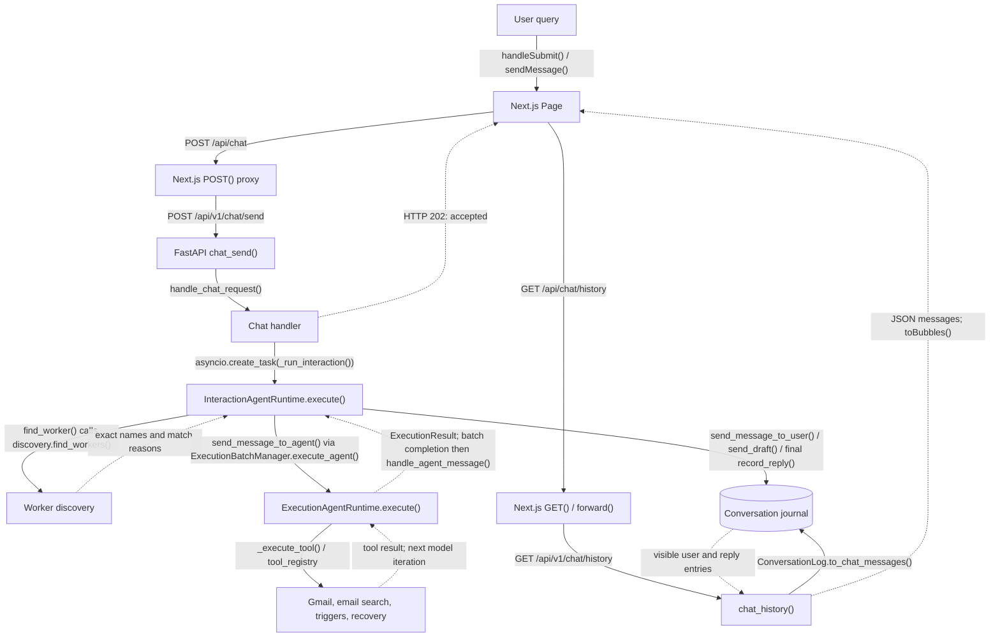
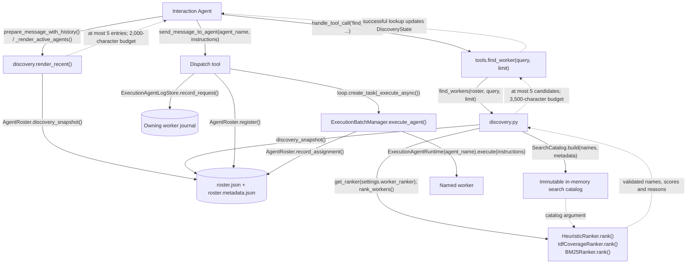
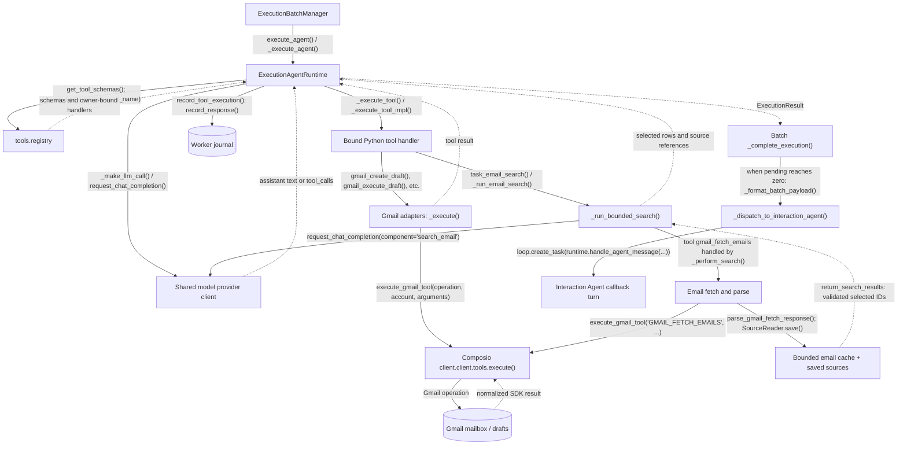
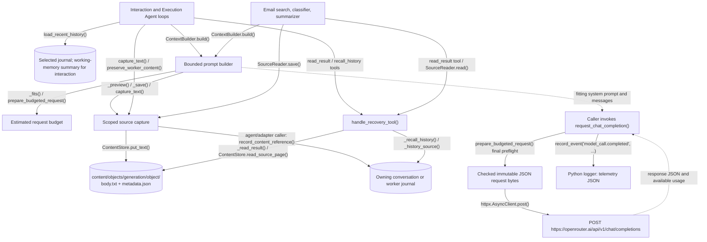
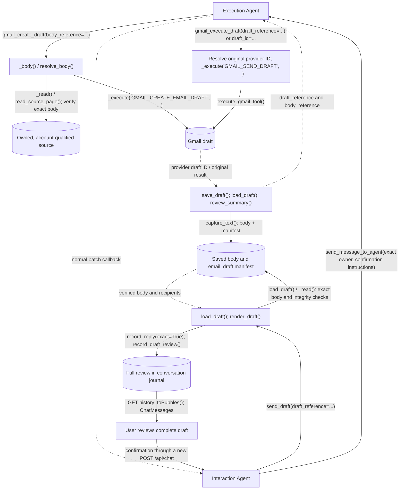
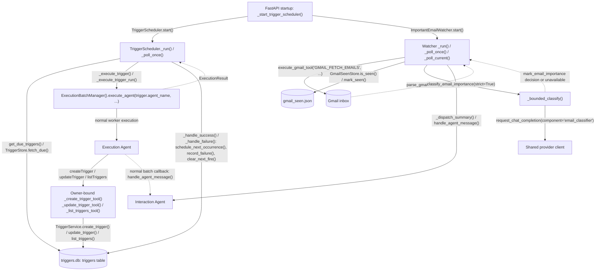
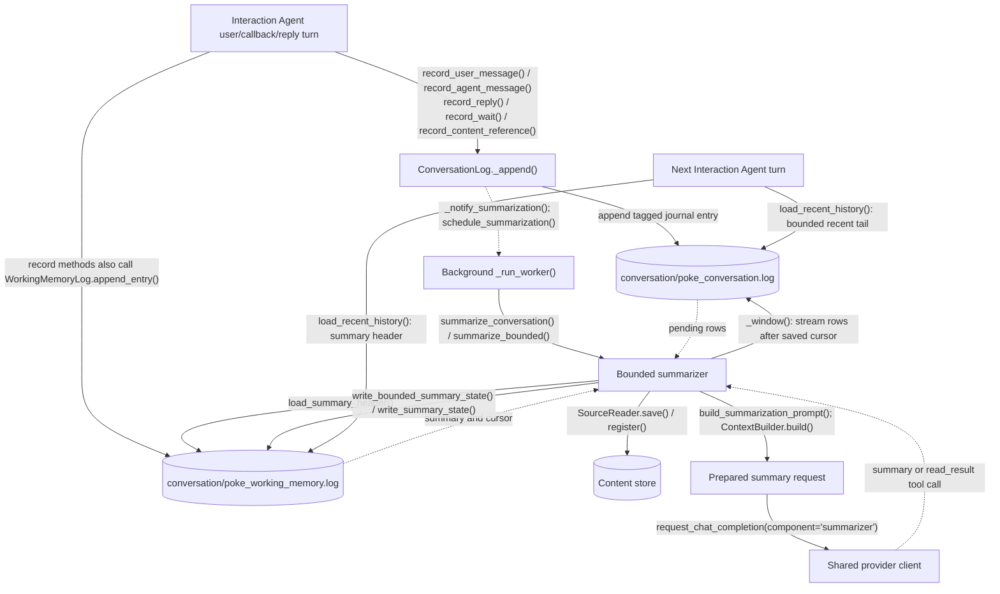
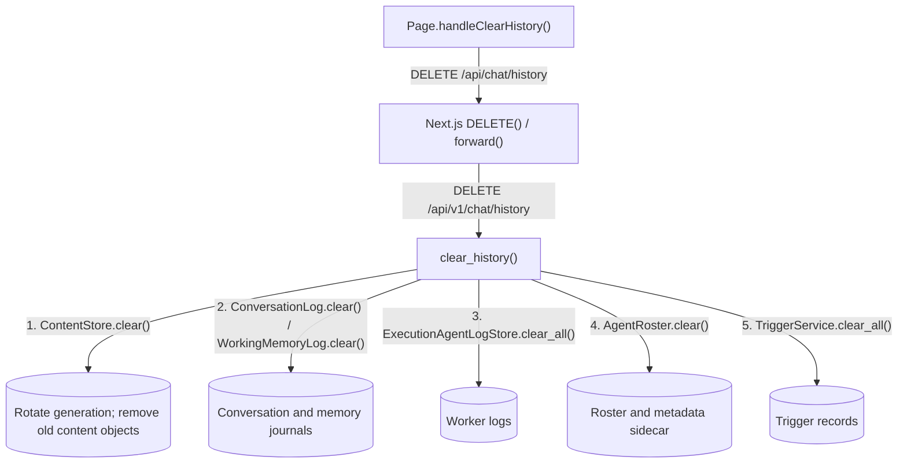

# OpenPoke runtime map

Verified against commit `b8a9c32` on 2026-11-11. This maps the default bounded discovery/context paths in the current source. `OPENPOKE_WORKER_RANKER` defaults to `heuristic_v1`; `idf_v1` and `bm25_v1` are selectable alternatives. Explicit legacy settings take different history/prompt paths.

Arrows name real HTTP endpoints, model-facing tools, or Python/TypeScript functions. A label containing several calls describes their call chain. Cylinders represent stored data. Dotted arrows describe returned data or background scheduling. Repeated nodes across diagrams refer to the same component.

`find_worker()` is the model-facing Interaction Agent tool. It calls `discovery.find_workers()` to retrieve candidate names. Worker execution is started separately by `send_message_to_agent()`; lookup does not dispatch work or authorize actions.

## 1. User query to response



The handler extracts the most recent nonempty user message. The server's journals supply historical context; the client does not resend the full authoritative history. A model may answer directly without creating a worker. Both agents use model/tool loops, capped at eight iterations.

The UI polls history every 1.5 seconds and also performs a temporary one-second response-check loop after submission. Only `user_message` and `poke_reply` journal entries become chat bubbles. Internal callbacks, waits and reference markers remain orchestration records. A failed background chat turn writes a user-visible failure reply.

Sources: [Page](../web/app/page.tsx), [chat proxy](../web/app/api/chat/route.ts), [history proxy](../web/app/api/chat/history/route.ts), [chat routes](../server/routes/chat.py), [chat handler](../server/services/conversation/chat_handler.py), [interaction runtime](../server/agents/interaction_agent/runtime.py).

## 2. Discovery, ranking and dispatch



`roster.json` is authoritative membership. The metadata sidecar provides purpose, recent assignment and last activity; rebuilding it does not rebuild worker histories. Search is over the entire roster snapshot, including workers outside the recent list. The search catalog and ranking statistics are built in memory; no persistent search index is introduced.

An existing exact name can be reused directly. If names already exist, creating another worker requires a successful discovery attempt in that Interaction Agent loop. Failed lookup revokes that permission. `register()` rechecks names and filename collisions under a local lock. Discovery returns candidates; the Interaction Agent model decides which exact names to dispatch.

Sources: [prompt builder](../server/agents/interaction_agent/agent.py), [interaction tools](../server/agents/interaction_agent/tools.py), [discovery](../server/services/execution/discovery.py), [ranking](../server/services/execution/ranking.py), [roster](../server/services/execution/roster.py).

## 3. Worker tools, Gmail and the callback



The batch manager wraps each worker execution in `asyncio.wait_for()` with a default 90-second timeout. Pending counts/results are process memory, not a durable queue. Callbacks carry the content generation and trace correlation where available.

The search model sees tool names `gmail_fetch_emails`, `read_result` and `return_search_results`. Its active fetch handler is `_perform_search()` in `search_email/tool.py`; the same-named wrapper in `gmail_internal.py` is not the active loop's execution path. Successful completion validates returned IDs against fetched results.

Public Gmail tool mappings:

| Model-facing tool / Python adapter | Composio operation |
| --- | --- |
| `gmail_create_draft()` | `GMAIL_CREATE_EMAIL_DRAFT` |
| `gmail_execute_draft()` | `GMAIL_SEND_DRAFT` |
| `gmail_forward_email()` | `GMAIL_FORWARD_MESSAGE` |
| `gmail_reply_to_thread()` | `GMAIL_REPLY_TO_THREAD` |
| `gmail_delete_draft()` | `GMAIL_DELETE_DRAFT` |
| `gmail_get_contacts()` | `GMAIL_GET_CONTACTS` |
| `gmail_get_people()` | `GMAIL_GET_PEOPLE` |
| `gmail_list_drafts()` | `GMAIL_LIST_DRAFTS` |
| `gmail_search_people()` | `GMAIL_SEARCH_PEOPLE` |

`get_active_gmail_user_id()` chooses the routed account for each adapter. `_execute()` saves oversized original arguments/results using `preserve_worker_content()`, with the executed account attached. It also writes an auxiliary `gmail-execution-agent` action journal; the worker runtime separately records its own tool activity.

Sources: [batch manager](../server/agents/execution_agent/batch_manager.py), [worker runtime](../server/agents/execution_agent/runtime.py), [worker agent](../server/agents/execution_agent/agent.py), [registry](../server/agents/execution_agent/tools/registry.py), [Gmail adapters](../server/agents/execution_agent/tools/gmail.py), [email search](../server/agents/execution_agent/tasks/search_email/tool.py), [Gmail client](../server/services/gmail/client.py).

## 4. Every model request, source preservation and recovery



All five model-calling components use the shared provider client. The builder attempts bounded reconstruction; final preflight rejects a request that still exceeds its configured allowance. Accounting estimates serialized UTF-8 request bytes plus framing allowances, with output reservation/headroom. It is not native token counting.

`capture_scope()` binds an owner (`conversation` or `worker:<exact name>`) and generation. New saved objects use references `c1_<generation>_<object>`, preserving provider/account labels. Large original content is saved before a preview replaces it. Agent and adapter callers record references in their owning journals so later turns can find them. Summarizer snapshots are linked from working memory instead of being appended to the conversation being summarized; `capture_text()` itself does not write journal entries.

`read_result` retrieves bounded pages of saved content. `recall_history` streams one selected legacy journal. Inner model readers only accept references registered for their operation. Reads do not grant action permission. Missing historical originals cannot be reconstructed from a summary.

Default outer history selection reads at most 128 KiB and starts with up to four episodes. Recovery pages are at most 2 KiB; each outer turn has eight recovery calls, 32 KiB of accepted responses and 512 KiB of read/scan work. Required instructions that cannot fit fail explicitly. Complete tool-call/result groups are kept together.

Sources: [context builder](../server/context_builder.py), [budget helper](../server/context_budget.py), [provider client](../server/openrouter_client/client.py), [content store](../server/content_store.py), [recovery](../server/context_recovery.py), [inner sources](../server/inner_context.py), [telemetry](../server/observability.py).

## 5. Exact draft creation, review and sending



Small inline drafts remain supported. Referenced review resolves the entire exact body in backend code. `compact_review_lines()` can replace a verified large review with its exact reference in later model context while preserving the complete UI journal entry.

A Gmail `draft_id` and an OpenPoke `draft_reference` are different identifiers. References bind content/ownership; the existing agent instructions still require user confirmation. There is no durable approval ledger or external Gmail draft revision lock in this release. The arrows show the intended confirmed workflow, not a backend natural-language approval parser.

Sources: [draft content](../server/draft_content.py), [interaction send_draft](../server/agents/interaction_agent/tools.py), [Gmail adapters](../server/agents/execution_agent/tools/gmail.py), [conversation journal](../server/services/conversation/log.py), [frontend history mapping](../web/components/chat/history.ts).

## 6. Triggers and important-email callbacks



Trigger tools bind the exact worker owner with `partial(..., agent_name=...)`. `TriggerService` delegates SQL to `TriggerStore.insert()`, `fetch_one()`, `update()` and `list_for_agent()`. The scheduler polls every ten seconds by default, tracks in-flight trigger IDs, and reuses the normal batch/worker/callback path.

The watcher polls every sixty seconds by default, skips initial warmup messages, checks account-qualified seen IDs, and classifies eligible messages. Unavailable classification remains unseen for retry within the fetch window. Important summaries become Interaction Agent callback turns without passing through a worker first. Its retry set and delivery are not durable replay infrastructure.

Shutdown calls the scheduler and watcher `stop()` methods. Timezone preferences feed prompt rendering, trigger time conversion and mailbox processing.

Sources: [app lifecycle](../server/app.py), [trigger adapters](../server/agents/execution_agent/tools/triggers.py), [trigger service](../server/services/triggers/service.py), [trigger store](../server/services/triggers/store.py), [scheduler](../server/services/trigger_scheduler.py), [watcher](../server/services/gmail/importance_watcher.py), [classifier](../server/services/gmail/importance_classifier.py).

## 7. Conversation storage and background memory



The working-memory file holds summary text, resume metadata and mirrored entries. Resume metadata includes `last_index`, `source_offset`, `source_identity` and `source_generation`. The summarizer commits only the successfully processed prefix after generation/source checks. The canonical conversation remains the source of historical entries.

Sources: [conversation log](../server/services/conversation/log.py), [memory log](../server/services/conversation/summarization/working_memory_log.py), [summary scheduling](../server/services/conversation/summarization/scheduler.py), [bounded summarizer](../server/services/conversation/summarization/bounded.py).

## 8. Storage layout, configuration and clearing

`get_data_dir()` resolves `Settings.data_dir`. The default is `server/data/`; `OPENPOKE_DATA_DIR` selects another root before application imports/startup.

```text
<data_root>/
├── conversation/
│   ├── poke_conversation.log       canonical user, reply and orchestration entries
│   └── poke_working_memory.log     summary, cursor metadata and mirrored entries
├── execution_agents/
│   ├── roster.json                authoritative exact worker names
│   ├── roster.metadata.json       rebuildable discovery fields
│   └── <slugified-worker>.log     requests, actions, results and source references
├── content/
│   ├── generation.json            current history generation
│   └── objects/<generation>/<object>/
│       ├── body.txt               immutable saved UTF-8 content
│       └── metadata.json          owner, mailbox, kind, length and hash
├── triggers.db                    SQLite trigger records
├── gmail/
│   └── active_user_id.txt          current Composio routing user/account identifier
├── gmail_seen.json                account-qualified watcher seen IDs
└── timezone.txt                   selected timezone
```

`ExecutionAgentLogStore.record_request()`, `record_action()`, `record_tool_response()`, `record_agent_response()` and `record_content_reference()` all write through `_append()` to the selected worker journal. Discovery metadata is separate from that history. Draft manifests and body snapshots are content-store objects; the actual Gmail drafts/messages remain in Gmail.

Browser `localStorage` separately stores `user_timezone`, `openpoke_user_id`, `gmail_connection_request_id`, `gmail_connected` and `gmail_email`. Composio profile cache, ranking catalog, agent loop messages, pending batches and recovery counters are in process memory. Telemetry goes to the Python logging sink; the app configures no dedicated telemetry database/file.



Clearing history leaves Gmail connection state, seen IDs, timezone and unrelated files intact. Old content references and generation-bound late writes/callbacks fail after clearing; clearing does not cancel already-running external actions.

Sources: [data root](../server/data_paths.py), [settings](../server/config.py), [worker journals](../server/services/execution/log_store.py), [clear route](../server/routes/chat.py), [seen store](../server/services/gmail/seen_store.py), [timezone store](../server/services/timezone_store.py), [browser settings](../web/components/SettingsModal.tsx).

## 9. HTTP and setup API index

The browser normally calls Next.js routes; those proxy to FastAPI. Internal model tools are Python function dispatch, not additional HTTP endpoints. `PY_SERVER_URL` defaults to `http://localhost:8001`; `PY_CHAT_PATH` can override the default backend send path.

| Browser endpoint | Backend endpoint | Handler chain / storage effect |
| --- | --- | --- |
| `POST /api/chat` | `POST /api/v1/chat/send` | `POST()` → `chat_send()` → `handle_chat_request()` → `InteractionAgentRuntime.execute()` |
| `GET /api/chat/history` | `GET /api/v1/chat/history` | `GET()` → `chat_history()` → `ConversationLog.to_chat_messages()` |
| `DELETE /api/chat/history` | `DELETE /api/v1/chat/history` | `DELETE()` → `clear_history()` → managed history stores above |
| `POST /api/gmail/connect` | `POST /api/v1/gmail/connect` | `gmail_connect()` → `initiate_connect()` → `client.connected_accounts.link()`; returns OAuth redirect |
| `POST /api/gmail/status` | `POST /api/v1/gmail/status` | `gmail_status()` → `fetch_status()` → connected-account status/profile lookup → `_set_active_gmail_user_id()` |
| `POST /api/gmail/disconnect` | `POST /api/v1/gmail/disconnect` | `gmail_disconnect()` → `disconnect_account()` → `client.connected_accounts.delete()`; clears matching active account/cache |
| `POST /api/timezone` | `POST /api/v1/meta/timezone` | `set_timezone()` → `TimezoneStore.set_timezone()` → `timezone.txt` |
| Direct backend request | `GET /api/v1/meta/timezone` | `get_timezone()` → `TimezoneStore.get_timezone()` |
| Direct backend request | `GET /api/v1/health` | `health()` |
| Direct backend request | `GET /api/v1/meta` | `meta()` lists registered API paths |

Sources: [API router](../server/routes/__init__.py), [Gmail routes](../server/routes/gmail.py), [meta routes](../server/routes/meta.py), [Gmail connection service](../server/services/gmail/client.py), [timezone proxy](../web/app/api/timezone/route.ts).

## 10. Tool names versus implementation names

| Model-facing API | Executed implementation |
| --- | --- |
| `find_worker` | Interaction `handle_tool_call()` → `find_worker()` → `discovery.find_workers()` |
| `send_message_to_agent` | Interaction `send_message_to_agent()` → asynchronous batch dispatch |
| `send_message_to_user` | `send_message_to_user()` → `ConversationLog.record_reply()` |
| `send_draft` | `send_draft()` → optional `load_draft()` → full journal review |
| `wait` | `wait()` → `ConversationLog.record_wait()`; no visible bubble |
| `read_result` | `handle_recovery_tool()` → `_read_result()` → `ContentStore.read_source_page()` |
| `recall_history` | `handle_recovery_tool()` → `_recall_history()` → selected journal scan |
| `task_email_search` | `task_email_search()` → `_run_email_search()` → `_run_bounded_search()` |
| Search-model `gmail_fetch_emails` | `_perform_search()` → `execute_gmail_tool('GMAIL_FETCH_EMAILS', ...)` |
| Search-model `return_search_results` | Completion branch inside `_run_bounded_search()`; validates successful lookup and selected IDs against fetched messages |
| Classifier `mark_email_importance` | Decision branch inside `_bounded_classify()` |
| `createTrigger` | `_create_trigger_tool()` bound to exact `agent_name` |
| `updateTrigger` | `_update_trigger_tool()` bound to exact `agent_name` |
| `listTriggers` | `_list_triggers_tool()` bound to exact `agent_name` |

Offline tests and evaluation scripts call these runtime paths with disposable storage and fake providers. They are outside the production query flow. Deferred workflow/migration storage remains archived and has no active edge in this map.
